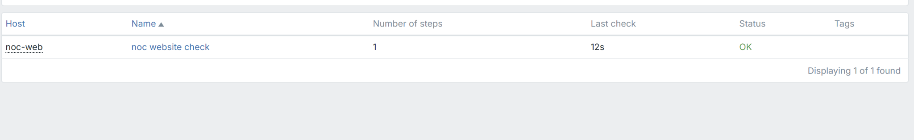

# ניטור אתר Nginx באמצעות Zabbix

כיצד מאבחנים תקלה באתר כשההתראה אומרת רק `NOC web service unavailable`? במעבדת NOC מקומית יצרתי שלוש תקלות מבוקרות באותו אתר. בכל תרגיל בדקתי מה קיבל המשתמש, זיהיתי את הסיבה, החזרתי את האתר לפעילות ואימתתי את סגירת האירוע ב־Zabbix.

| תרגיל ודוח | מה התקבל בבקשה לאתר | מה תיקן את התקלה | משך האירוע ב־Zabbix |
| --- | --- | --- | --- |
| [1 · קונטיינר עצור](incidents/01-nginx-stopped.md) | החיבור נכשל לפני שהתקבלה תשובת HTTP | הפעלת הקונטיינר | 2 דקות ו־55 שניות |
| [2 · דף בית חסר](incidents/02-missing-index.md) | `403 Forbidden` | החזרת הקובץ לשמו המקורי | 5 דקות |
| [3 · דף בית עם תוכן שגוי](incidents/03-wrong-content.md) | `200 OK` עם הטקסט `Maintenance error` | שחזור תוכן הדף מגיבוי | 3 דקות |

הזמנים נמדדו מפתיחת ההתראה ועד סגירתה. הבדיקה רצה פעם בדקה, ולכן זמני ההתראה עשויים להיות שונים מהזמנים שבהם השתנה האתר בפועל.

## סביבת המעבדה

הפעלתי את הפקודות מתוך Ubuntu ב־WSL 2. ב־Docker Desktop רצו אתר Nginx בקונטיינר `noc-web`, שרת Zabbix 8.0, ממשק הניהול ומסד PostgreSQL. את סביבת הניטור העליתי באמצעות `compose_pgsql.yaml` מתוך [המאגר הרשמי של Zabbix](https://github.com/zabbix/zabbix-docker).

| נקודת גישה | כתובת במעבדה | שימוש |
| --- | --- | --- |
| Ubuntu במחשב המארח | `http://127.0.0.1:8082/` | בדיקה ידנית של האתר באמצעות curl |
| שרת Zabbix ברשת Docker המשותפת | `http://noc-web/` | בדיקה מחזורית של אותו אתר לפי שם הקונטיינר |
| דפדפן במחשב המארח | `http://localhost:8282/` | צפייה בבדיקות ובהתראות בממשק Zabbix |

## הגדרת הניטור

במארח `noc-web` הגדרתי תרחיש Web בשם `noc website check`. התרחיש שולח בקשה לדף הבית פעם בדקה ודורש קוד תשובה `200`. בתרגיל השלישי הוספתי לשלב הבדיקה את הטקסט `Welcome to nginx!` בשדה **Required string**, כדי לזהות גם דף שגוי שהשרת מצליח למסור.

הטריגר `NOC web service unavailable`, בדרגת חומרה `High`, בודק את התוצאה האחרונה של התרחיש. הערך 0 מציין שכל השלבים הצליחו. ערך חיובי מציין את מספר השלב שנכשל.

```text
last(/noc-web/web.test.fail[noc website check])<>0
```



שלושת הדוחות כוללים פקודות אבחון ותיקון וצילומים מהתרגיל ב־18 בנובמבר 2026. בחלק מהצילומים מופיעה גם התראת Agent על המארח `Zabbix server`. האירועים של אתר המעבדה מופיעים בשורות של `noc-web`.
