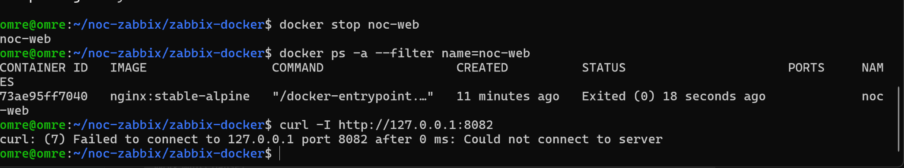

# תקלה 1 · החיבור לאתר נכשל

עצרתי במכוון את הקונטיינר שמריץ את Nginx באמצעות `docker stop noc-web`. מנקודת המבט של המשתמש, ניסיון לפתוח את האתר נכשל כבר בשלב החיבור.

## אבחון

```bash
docker ps -a --filter name=noc-web
curl -I http://127.0.0.1:8082/
```

Docker הציג `Exited (0)`, כצפוי אחרי עצירה יזומה. בדיקת curl הסתיימה בשגיאה 7 והציגה `Could not connect to server`. בשעה 13:34:11 פתח Zabbix אירוע בדרגת `High` על המארח `noc-web`.



[צילום פתיחת האירוע ב־Zabbix](../screenshots/03-zabbix-problem.png)

## תיקון ואימות

```bash
docker start noc-web
curl -s http://127.0.0.1:8082/
```

הפעלתי מחדש את הקונטיינר הקיים. בבקשת HTTP התקבל שוב דף הבית עם הכותרת `Welcome to nginx!`. בשעה 13:37:06 הציג Zabbix את האירוע כ־`RESOLVED`, לאחר 2 דקות ו־55 שניות.

[דף הבית שהתקבל לאחר ההפעלה](../screenshots/05-recovery-http-response.png) · [סגירת האירוע](../screenshots/04-zabbix-resolved.png)
