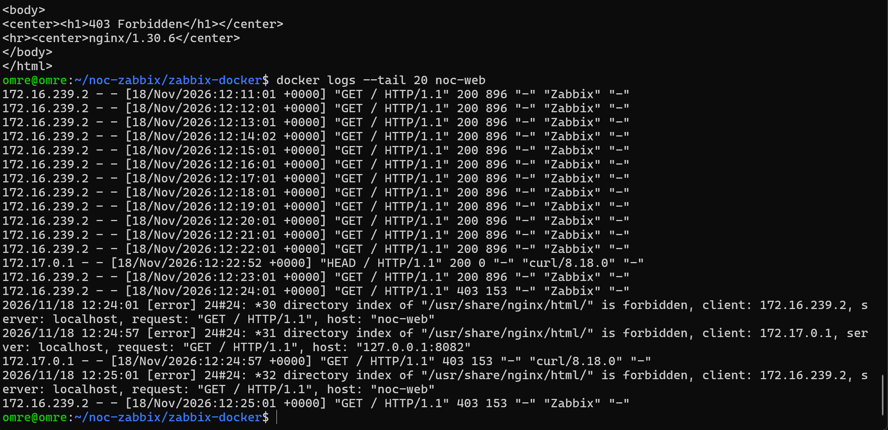

# תקלה 2 · Nginx מחזיר 403 לדף הבית

בתחילת התרגיל החזיר דף הבית `200 OK`. שיניתי את שם הקובץ `index.html` ל־`index.html.bak` בתוך תיקיית האתר. הקונטיינר המשיך לרוץ, אך בקשה לנתיב `/` החזירה `403 Forbidden`.

[בדיקת דף הבית לפני השינוי](../screenshots/05-missing-index-before.png) · [שינוי שם הקובץ ובדיקת מצב הקונטיינר](../screenshots/06-inject-fault-docker-ps.png)

## אבחון

```bash
docker ps --filter name=noc-web
curl -i http://127.0.0.1:8082/
docker logs --tail 20 noc-web
```

מצב `Up` ותשובת HTTP הראו ש־Nginx פעל וקיבל את הבקשה. הלוג הציג מעבר מבקשות מוצלחות לקוד 403 ואת ההודעה `directory index of "/usr/share/nginx/html/" is forbidden`. לאחר שינוי השם, Nginx לא מצא דף ברירת מחדל להגשה והגדרותיו מנעו הצגה של רשימת הקבצים בתיקייה.



[תשובת 403 בטרמינל](../screenshots/07-curl-403.png) · [פתיחת האירוע בשעה 14:24:01](../screenshots/09-zabbix-problem-403.png)

## תיקון ואימות

```bash
docker exec noc-web mv /usr/share/nginx/html/index.html.bak /usr/share/nginx/html/index.html
curl -I http://127.0.0.1:8082/
```

החזרתי את הקובץ לשמו המקורי. Nginx הגיש שוב את דף הבית עם `200 OK` ואורך תשובה של 896 בתים. בשעה 14:29:01 נסגר האירוע ב־Zabbix, חמש דקות לאחר פתיחתו.

[פקודת התיקון ותשובת 200](../screenshots/10-fix-curl-200.png) · [סגירת האירוע](../screenshots/11-zabbix-resolved-403.png)
