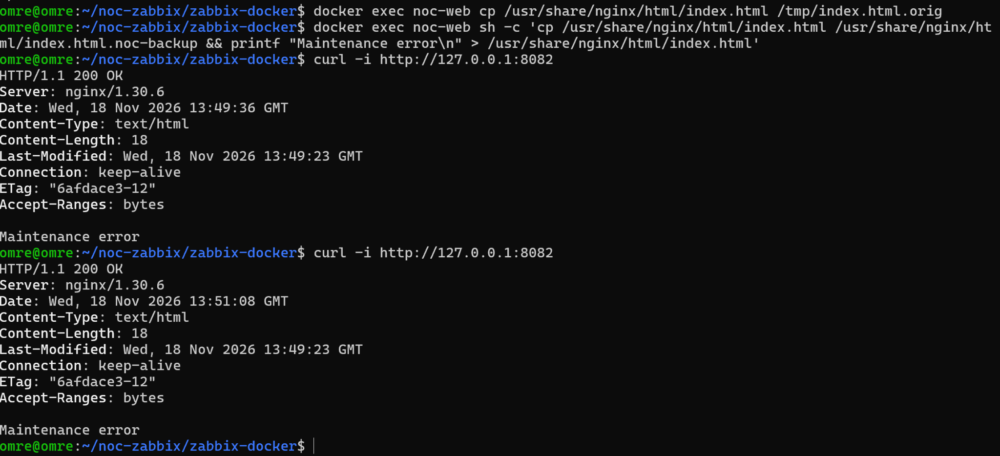
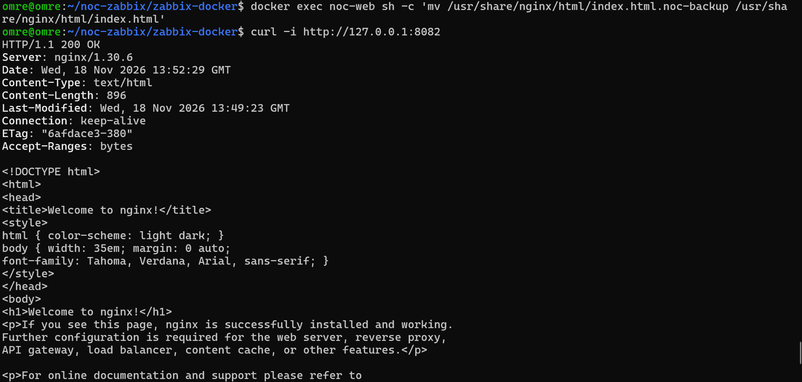

# תקלה 3 · האתר מחזיר 200 עם תוכן שגוי

הוספתי לבדיקת דף הבית דרישה להופעת הטקסט `Welcome to nginx!`. לאחר שגיביתי את `index.html`, החלפתי את תוכנו בשורה `Maintenance error`. Nginx המשיך לענות לבקשות כרגיל, והמשתמש קיבל את הודעת התחזוקה.

## אבחון

```bash
curl -i http://127.0.0.1:8082/
```

הפקודה הציגה את הכותרות ואת גוף התשובה יחד. הקוד היה `HTTP/1.1 200 OK`, אבל הגוף הכיל רק `Maintenance error` ושורת סיום, בסך 18 בתים. בדיקת קוד התשובה לבדו הייתה עוברת. דרישת התוכן אפשרה לתרחיש לזהות את הכשל ולפתוח אירוע בשעה 15:50:01.



[פתיחת האירוע ב־Zabbix](../screenshots/06-content-alert.png)

## תיקון ואימות

```bash
docker exec noc-web sh -c 'mv /usr/share/nginx/html/index.html.noc-backup /usr/share/nginx/html/index.html'
curl -i http://127.0.0.1:8082/
```

החזרתי את קובץ הגיבוי למיקום שממנו Nginx מגיש את דף הבית. בבדיקה החוזרת התקבלו 896 בתים ובגוף הדף הופיעה שוב הכותרת `Welcome to nginx!`. קוד התשובה נשאר 200 לאורך התרגיל. חזרת התוכן המקורי וסגירת ההתראה הן שאימתו את התיקון.



Zabbix הציג `RESOLVED` בשעה 15:53:01. האירוע נמשך שלוש דקות. [צילום סגירת האירוע](../screenshots/09-content-resolved.png)
